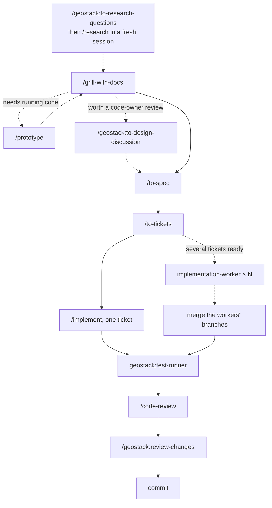

# Workflows

How to get work done with geostack and Matt Pocock's skills, one situation at a time. Matt's skills
run the process. geostack adds stack knowledge and specialist agents at certain steps
([ADR-0013](adr/0013-process-belongs-to-matt-pocock-skills.md)).

To ask from inside a session instead of reading: `/geostack:ask <your situation>`.

In the steps below, **You** means you typing in the session, **Claude** means the main session,
and a name like **`geostack:test-runner`** means a subagent that Claude delegates to.

## Find your situation

| Situation | Workflow |
|---|---|
| A repo without geostack or Matt's skills yet | [Set up a new project](#set-up-a-new-project) |
| A small feature or bugfix that fits one session | [Everyday change](#everyday-change) |
| A feature that needs a spec and spans several sessions | [Larger feature](#larger-feature) |
| Several tickets with all their blockers closed | [Parallel tickets](#parallel-tickets) |
| A ticket in code that you or the session don't know yet | [Ticket in unfamiliar code](#ticket-in-unfamiliar-code) |
| A design to show the code owner before the spec | [Design review by the code owner](#design-review-by-the-code-owner) |
| An API in Django or FastAPI plus a React view | [Fullstack feature](#fullstack-feature) |
| A new screen or component | [New UI view](#new-ui-view) |
| A frontend without a design system | [Building a design system](#building-a-design-system) |
| Spatial data from PostGIS on a web map | [Map with spatial data](#map-with-spatial-data) |
| A model change, a migration or a slow query | [Database migration or query](#database-migration-or-query) |
| An app in the cluster is down or out of sync | [Something is broken in the cluster](#something-is-broken-in-the-cluster) |
| A red pipeline | [Red CI](#red-ci) |
| A bug that resists a first look, a flaky test | [Hard or intermittent bug](#hard-or-intermittent-bug) |
| A library or tool upgrade, a new technology | [Upgrade or new technology](#upgrade-or-new-technology) |
| A decision worth recording | [Architecture decision](#architecture-decision) |
| Learning something while doing a real task | [Learning on a task](#learning-on-a-task) |
| Bug reports and requests from other people | Matt's `/triage`. geostack has no part in it. |
| Cleaning up the architecture | Matt's `/improve-codebase-architecture`. Knowledge skills give stack context for the chosen candidate. |
| Whether to continue, `/clear`, `/compact` or `/handoff` | `/ask-matt` |

---

## The main flow

Most work follows this path. Dashed arrows are optional detours.



1. **You** run `/grill-with-docs` with the idea or the ticket. Claude interviews you and writes
   `CONTEXT.md` (the project's glossary) and ADRs (records of decisions). geostack's knowledge
   skills suggest the questions and defaults typical for the stack: storage CRS, design system
   foundation, GitOps layout. `geostack:docs-researcher` answers questions that depend on a
   library version.
   - A question that only running code can settle: `/handoff`, `/prototype` in a fresh session,
     `/handoff` back with the conclusions.
   - A ticket in code nobody has read yet: start with [Ticket in unfamiliar code](#ticket-in-unfamiliar-code).
   - A design the code owner should see first: [Design review by the code owner](#design-review-by-the-code-owner).
2. **You** run `/to-spec`. Its "Testing Decisions" section names the *seams*, the places where
   tests attach to the code. Confirm them: workers and `/tdd` test only there.
3. **You** run `/to-tickets`. Tickets land in the tracker, each with the tickets that block it.
   Keep steps 1–3 in one context window, without `/clear`.
4. **You** run `/implement` for one ticket, and `/clear` before the next one. `/tdd` inside it
   writes a failing test, then the code. Knowledge skills load by themselves from the file paths.
   Several tickets ready at once: [Parallel tickets](#parallel-tickets).
5. **`geostack:test-runner`** runs the final tests, linters and type checks, keeping the logs out
   of your context.
6. **You** review the diff against a *fixed point* (the branch or commit you compare with, usually
   `main`): `/code-review main`, then `/geostack:review-changes main`.
7. **You** fix what the review found and commit.

### Review: three axes

| Axis | Run with | Asks |
|---|---|---|
| **Standards** | `/code-review` | Does the code follow the repo's documented standards? Any code smells? |
| **Spec** | `/code-review` | Does the diff do what the ticket asked, no less and no more? |
| **Risk** | `/geostack:review-changes` | What will break: correctness, regressions, test gaps, security, migration locks, deploy, UI states, stale docs and `CONTEXT.md`. |

Run the Risk axis when the diff touches auth, the database, infrastructure or the frontend. It
always runs `code-reviewer`, and adds a specialist per kind of file: `security-reviewer`
(endpoints, permissions, uploads, tokens), `postgres-reviewer` (models, migrations, queries),
`platform-reviewer` (Docker, Kubernetes, CI) and `frontend-reviewer` (`.ts`, `.tsx`). The three
axes are reported separately and never merged or ranked together.

---

## Set up a new project

**When:** a repo where neither geostack nor Matt's skills are installed yet.

1. **You** install geostack for the project and commit the `.claude/settings.json` it writes:
   ```bash
   claude plugin install geostack@dampe --scope project
   ```
2. **You** add Matt's skills: `npx skills@latest add mattpocock/skills`.
3. **You** run `/geostack:setup-geostack` in a session. Claude reads the commands and the stack
   from the repo and asks only what it can't read:
   - the languages of the conversation, UI copy, docs and commit messages;
   - optional learning goals for `/geostack:mentor`;
   - the cluster, when the repo doesn't show it ("run by the ops team, details unknown" is a valid answer).

   It writes `CLAUDE.md` and the shared `.claude/settings.json`, copies the format and check hooks
   to `.claude/hooks/`, and lists the placeholders still open. What these settings do:
   [project-settings.md](project-settings.md).
4. **You** run `/setup-matt-pocock-skills`. It sets up the tracker, the triage labels and the
   layout of `CONTEXT.md` and ADRs, and appends its block to the same `CLAUDE.md`.
5. **You** run `/grill-with-docs` about the project itself: stack, CRS, design system foundation,
   deployment. The first ADRs and `CONTEXT.md` come out of it.
6. A frontend comes next? [Build the design system](#building-a-design-system) before the first
   screens. Then take the first feature through [Larger feature](#larger-feature) or
   [Everyday change](#everyday-change).

**Watch out:**
- Run step 3 before step 4. In the other order Matt's setup asks which file to create, and the
  `## Workflow` rules can end up apart from Matt's pointers.
- Don't create `CONTEXT.md` or `docs/adr/` up front, and remove Matt's skills the project doesn't
  need (e.g. `migrate-to-shoehorn` without TypeScript courses). Every unused skill description costs
  context on every turn.
- Don't enable a second process framework such as superpowers. Its skills compete for the same
  triggers. To disable it per project, add `"enabledPlugins": {"superpowers@claude-plugins-official": false}`
  to `.claude/settings.json`.

## Everyday change

**When:** a small feature or a bugfix that fits in one session and needs no spec.

1. **You** describe the change. Still unclear? Run a short `/grill-with-docs` first.
2. **You** run `/tdd` for one behavior, or `/implement` in the same session.
3. **`geostack:test-runner`** runs the final tests, linters and type checks.
4. **You** run `/code-review main`, then `/geostack:review-changes main`. Without a ticket the Spec
   axis reports "no spec available", and that's fine.
5. **You** fix and commit.

**Watch out:** the cause of the bug isn't obvious? Switch to [Hard or intermittent bug](#hard-or-intermittent-bug).

## Larger feature

**When:** a feature that needs a spec and takes several tickets or sessions.

1. **You** run `/grill-with-docs`, then `/to-spec` (confirm the seams), then `/to-tickets`, all in
   one context window. See [the main flow](#the-main-flow), steps 1–3.
2. **You** take the tickets whose blockers are closed:
   - one at a time: `/implement`, then `/clear` before the next ticket;
   - several at once: [Parallel tickets](#parallel-tickets).
3. **You** review each ticket's diff as in the main flow, steps 5–7, and close the ticket.
4. Repeat step 2 until no tickets are left.

**Watch out:**
- A feature with an API and a view is one vertical ticket, not "backend" and "frontend" tickets:
  see [Fullstack feature](#fullstack-feature).
- A migration of a large table is several tickets: see
  [Database migration or query](#database-migration-or-query).

## Parallel tickets

**When:** several tickets from `/to-tickets` have all their blockers closed (this set is the
*frontier*), and they don't touch the same files.

1. **You** ask Claude to hand each ticket to its own worker:
   ```
   Tickets #12, #13 and #15 have their blockers closed. Give each to a separate implementation-worker, in parallel.
   ```
2. **Each `geostack:implementation-worker`** works in its own git worktree. It reads its ticket and
   the parent spec, writes tests first at the seams, commits on its own branch and reports
   `Status`, `Branch`, `Commit`, acceptance criteria and verification.
3. **You** merge the workers' branches (`git merge <Branch>` for each report), then run
   `geostack:test-runner`, `/code-review` and `/geostack:review-changes` once, on the merged diff.
4. **You** close the tickets. The tickets they blocked form the next frontier: go back to step 1.

**Watch out:**
- A worker that finds an open blocker or no agreed seams stops with `Status: blocked` instead of guessing.
- Do overlapping tickets one at a time, even when neither formally blocks the other: shared files,
  or consecutive steps of one migration.

## Ticket in unfamiliar code

**When:** a ticket touches code that you or the session haven't read, and you want the facts
before the design.

1. **You** run `/geostack:to-research-questions <ticket>`. Claude writes questions about the
   current code, with no trace of what you plan to build.
2. **You** open a fresh session and run `/research` with only the questions file, never the
   ticket. You get `<area>-research.md`, with citations into the code.
3. **You** run `/grill-with-docs` with the ticket and the research file, and continue with
   [the main flow](#the-main-flow).

**Watch out:** the researcher must not see the ticket. One that knows the goal reports the code
that supports its favorite solution and skips the code that complicates it
([ADR-0015](adr/0015-qrspi-steps-extend-matts-flow.md)).

## Design review by the code owner

**When:** after `/grill-with-docs`, the design changes code someone else owns, and they should
review it before the spec is written.

1. **You** run `/geostack:to-design-discussion` in the same session as the grill. Claude writes
   about 200 lines: current state, target state, patterns to follow and to avoid, decisions
   (D1, D2…) and open questions. Every pointer to code is verified.
2. **You** send the document to the code owner.
3. **You** bring their comments back to the same session, resolve them, then run `/to-spec`.

## Fullstack feature

**When:** an API endpoint in Django or FastAPI plus a React view that uses it.

1. **Claude** builds the endpoint, the serializer or schema and its tests, with `/tdd` at the API
   seam. `django-conventions` or `fastapi-conventions` load by themselves.
2. **You** or Claude run `pnpm gen:api` to generate the TypeScript types and client from OpenAPI
   (`frontend-stack`). An API change that breaks the frontend now fails in `tsc`, not in production.
3. **Claude** builds the view as in [New UI view](#new-ui-view).
4. **You** review: `/code-review`, then `/geostack:review-changes`. It runs `security-reviewer` and
   `postgres-reviewer` on the backend and `frontend-reviewer` on the UI.
5. **`geostack:test-runner`** runs pytest and vitest, and Playwright for the critical flow.

**Watch out:** in `/to-tickets` this is one vertical ticket covering API, types and view.

## New UI view

**When:** a new screen or component.

1. **You** describe the view, e.g. "Build a list view of observations with a species filter".
   The layout itself is the open question? Try variants with `/prototype` first.
2. **Claude** (`building-ui`) finds the design system: tokens, `components/ui`, Storybook. It
   proposes the screen in 3–5 lines: goal, primary action, density, regions. **You** accept or correct.
3. **Claude** builds it only from the design system's tokens and components, with the loading,
   empty, error and overflow states.
4. **Claude** takes screenshots (`npx playwright screenshot` at 375 px, 1280 px and in dark mode),
   looks at them and fixes what's off.
5. **You** review. `frontend-reviewer` checks the code and takes its own screenshots.

**Watch out:** without a running dev server or Storybook, Claude must say plainly that nothing was
checked visually ([ADR-0009](adr/0009-ui-quality-through-design-system.md)).

## Building a design system

**When:** a project with a frontend but no design system, before its first screens.

1. **You** decide the product character, density and foundation (shadcn/ui with Tailwind v4,
   Mantine or Radix) in `/grill-with-docs`. The result is an ADR.
2. **Claude** sets up tokens from `skills/building-ui/assets/tokens.css`: palette, typography,
   density, contrast, shown in a Storybook "Tokens" page.
3. **Claude** builds components from the list of screens: primitives, then composites, then
   patterns, each with stories for all its states.
4. **Claude** adds enforcement: a lint rule against arbitrary values, visual tests of the stories
   in CI, and a Design section in `CLAUDE.md`.

From then on, a missing component goes into the design system first and the feature second. A token
change comes with before and after screenshots. The full guide: [design-system.md](design-system.md).

## Map with spatial data

**When:** data from PostGIS shown on a map in React, e.g. "a layer of forest stands, filtered by species".

1. **You** choose the map library in `/grill-with-docs` (the result is an ADR). `web-maps` gives
   the trade-off: MapLibre for data in EPSG:3857, OpenLayers for WMTS in a national CRS such as EPSG:2180.
2. **You** choose the transport by data size: GeoJSON below about 5,000 features, vector tiles (MVT)
   from PostGIS with `ST_AsMVT` above that. `postgres-reviewer` checks the tile query.
3. **Claude** lays out the screen with `building-ui` (its data-dense and maps reference): map with
   a side panel, a bottom sheet on mobile, a legend.
4. **Claude** keeps the view state in the URL and loads data through TanStack Query, by bounding
   box and with an `AbortSignal`.
5. **You** review. `frontend-reviewer` checks the map instance, effect cleanup and the accessibility
   of map controls.

## Database migration or query

**When:** a new or changed model, a migration, or a query that is slow.

1. **You** or Claude write the model or migration. `postgres-postgis` suggests safe patterns.
2. **You** print the SQL (`python manage.py sqlmigrate app 00NN`) and ask:
   ```
   postgres-reviewer, assess this migration; the table has ~40M rows
   ```
3. **`geostack:postgres-reviewer`** reports the lock level and the risk, and gives an
   `EXPLAIN (ANALYZE, BUFFERS)` to run.
4. **You** run it on data shaped like production, paste the result and decide.

**Watch out:** a large table changes in three steps, each its own ticket blocked by the previous one:
add the new structure (*expand*), move the data, remove the old structure (*contract*).
A slow query whose cause doesn't show up: [Hard or intermittent bug](#hard-or-intermittent-bug),
with EXPLAIN as the feedback loop.

## Something is broken in the cluster

**When:** an app in Kubernetes is down or stuck: CrashLoopBackOff, Pending, ArgoCD OutOfSync, a
failing Tekton run.

1. **You** describe the symptom:
   ```
   cluster-investigator: the forest-web app hasn't been responding since this morning
   ```
2. **`geostack:cluster-investigator`** reads the cluster: context, `get`, `describe`, logs, events,
   `argocd app get` and `diff`. It reports the cause (confirmed or likely), the evidence and a fix.
3. **You** apply the fix in the GitOps repo, not with `kubectl apply`.
4. **You** run `/geostack:review-changes` (it adds `platform-reviewer`), commit, and let ArgoCD sync.

**Watch out:** the agent fixes nothing itself, and the read-only hook blocks its `apply`, `delete`,
`exec` and printing of Secrets. No cause after one run: [Hard or intermittent bug](#hard-or-intermittent-bug),
with the investigator supplying evidence.

## Red CI

**When:** a pipeline failed in GitHub Actions, GitLab CI or Tekton.

1. **You** paste the link or the log and ask "test-runner, diagnose".
2. **`geostack:test-runner`** reproduces the failure with the same commands CI runs, and classifies
   it: a bug, a wrong test, the environment, a flaky test, or "needs diagnosis".
3. **Claude** fixes it in the main session.

**Watch out:**
- "Needs diagnosis" goes to [Hard or intermittent bug](#hard-or-intermittent-bug), with the
  test-runner's command as the loop.
- The pipeline definition itself is broken? Review it with `platform-reviewer`. `ci-pipelines`
  knows the linters: `actionlint`, `glab ci lint`, `tkn`.

## Hard or intermittent bug

**When:** a bug that resists a first look, a flaky test, or a regression between two known-good states.

1. **You** run `/diagnosing-bugs`. It refuses to guess until it has one command that fails on this bug.
2. geostack supplies that command:
   - `geostack:test-runner` for a failing test or CI job;
   - `EXPLAIN` from `postgres-reviewer` for a slow query;
   - evidence from `cluster-investigator` for the cluster.
3. **Claude** fixes the bug with a regression test, and you review as in [the main flow](#the-main-flow).

## Upgrade or new technology

**When:** a library or tool upgrade, a new option, or a deprecation, so the answer depends on versions.

1. **You** ask, e.g.:
   ```
   docs-researcher: what changes when upgrading ArgoCD from 2.x to 3.x in our setup?
   ```
2. **`geostack:docs-researcher`** reads the versions in the repo (`Chart.yaml`, lockfiles), then the
   official release notes, and reports with sources. Want the result kept in the repo? Use `/research` instead.
3. The upgrade changes an earlier decision? **You** record it in `/grill-with-docs` as a new ADR
   that supersedes the old one.
4. **You** implement it as a [Larger feature](#larger-feature) or an [Everyday change](#everyday-change).

## Architecture decision

**When:** a choice that is hard to reverse, surprising without context, and between real
alternatives. All three must hold.

1. **You** talk it through in `/grill-with-docs`, e.g. "do we store geometries in EPSG:2180 or 4326?"
2. **Claude** (`domain-modeling`) writes `docs/adr/NNNN-….md` and adds new terms to `CONTEXT.md`.
3. **Claude** adds a one-line pointer to the ADR in `CLAUDE.md` and an `ADR-NNNN` comment next to
   the code it constrains (`documenting-code`).

**Watch out:** `code-reviewer` flags a missing ADR by the same three criteria.

## Learning on a task

**When:** you want to learn a technology while doing a real task with it: homelab, platform
engineering, frontend.

1. **You** start the mentor with the task: `/geostack:mentor set up ArgoCD with app-of-apps on my k3s`.
2. **Claude** gives a mental model in up to 10 lines, the common pitfalls and a link to the docs.
3. **Claude** builds the scaffolding. **You** write the parts marked `TODO(human)`.
4. **Claude** asks you to predict a result ("what will `argocd app diff` show?"). You run it and compare.
5. **Claude** reviews your code like a senior would, and ends with a summary, an exercise and an
   entry in `LEARNING.md`.

**Watch out:** say "just do it" and the mentor switches to normal mode. For a plan across many
sessions, use `/teach` in a separate directory, and practice its milestones here with the mentor.

---

## What to avoid

- `/geostack:review-changes` **instead of** `/code-review`. It adds the Risk axis; it doesn't replace the other two.
- ADRs in any format other than `domain-modeling`'s.
- A worker given a ticket with an open blocker or without agreed seams.
- Triaging tickets that `/to-tickets` produced. They are ready for an agent by design.
- Editing Matt's skills. Adjust geostack, or the `## Workflow` section in the project's `CLAUDE.md`.
- A second process framework next to these two.

## Without Matt's skills

geostack works on its own too: knowledge skills, reviewers, `test-runner`, `cluster-investigator`
and the read-only hook. References to `/code-review`, `/tdd`, `domain-modeling` and `docs/agents/`
are then skipped, and the Risk axis works as a regular review. geostack doesn't run a process or
write ADRs on its own.
